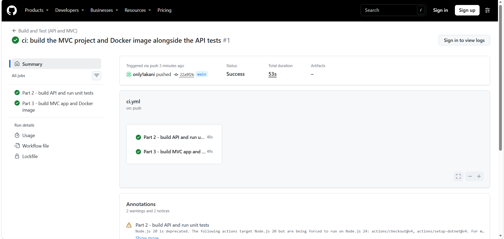
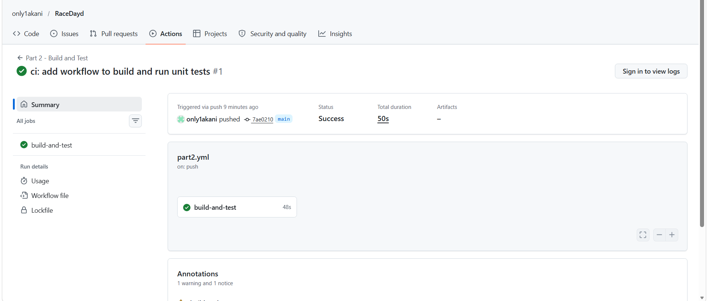

# RaceDay

RaceDay is a web-based event management system for the South African road running, walking and cycling community. This repository holds all three parts of the project.

| Part | Folder | What it is |
|---|---|---|
| Part 3 | `Part3` | ASP.NET Core MVC website, Azure Blob Storage, Docker |
| Part 2 | `Part2` | RESTful API with SQL Server, unit tests and CI |
| Part 1 | `docs` | ERD, API endpoint plan and SQL script |

## Part 3: MVC web application

**YouTube video (unlisted):** (https://youtu.be/0lOnwQc8lOk)

**GitHub repository:** https://github.com/only1akani/RaceDayd

The website (`Part3/RaceDay.Web`) is an ASP.NET Core MVC app that gives Organisers and Participants their own interface. It has no database access and no business logic of its own. Everything it shows or saves goes through the Part 2 API, using one class (`ApiClient`).

### How the pieces fit together

```
Browser  ->  MVC website (Docker, port 8080)  ->  Part 2 API (port 5022)  ->  SQL Server
                                                         |
                                                         +-->  Azure Blob Storage (images)
```

- **Sessions:** when a user logs in, the website calls the API, which creates its own session. The website keeps the API's session cookie inside the user's website session, together with the user id and role, and sends that cookie with every API call. Logging out ends both sessions.
- **Role protection:** a `[RoleAuthorize]` filter protects every page. Anyone not logged in is sent to the login page, and the wrong role is sent home with a message.
- **Azure Blob Storage:** images are uploaded from the website to the API, and the API stores them in Azure and saves the link. The website never talks to Azure directly.
- **Errors:** if the API is switched off, the pages show a friendly message instead of an error page.

### What each role can do

**Organiser**
- Dashboard with events created, upcoming events, total enrolments and enrolments awaiting confirmation
- My Events: create, edit and delete events (name, description, date, location, distance and event type) with a banner image upload
- Categories: add, edit and delete the distance or age categories of an event
- Enrolments: see every participant, their category and status, and confirm enrolments
- Results: capture finish times and positions after the event, which are published on the event page

**Participant**
- Events page with search and event type filters
- Event page with full details, the banner, categories and Enter Event
- My Events: every event entered, with a colour-coded status (green Confirmed, amber Pending), and cancel
- My Results: event, date, category, finish time and position (for example 2nd of 47 finishers)
- Profile: update name and email and upload a profile picture

### Setup and run instructions

**Requirements:** .NET 8 SDK, SQL Server LocalDB, the EF Core tool (`dotnet tool install --global dotnet-ef`), Docker Desktop, and an Azure Storage account.

1. Clone the repository:
   ```
   git clone https://github.com/only1akani/RaceDayd.git
   cd RaceDayd
   ```
2. Create the database (this also seeds the two roles):
   ```
   cd Part2
   dotnet ef database update --project RaceDay.Api
   ```
   The connection string in `Part2/RaceDay.Api/appsettings.json` uses a LocalDB instance called `api_guide`. Create it with `sqllocaldb create api_guide` and `sqllocaldb start api_guide` if you do not have it.
3. Set up Azure Blob Storage. In the Azure portal create a storage account with **blob anonymous access enabled**, then create two containers called `event-banners` and `profile-pictures` with the anonymous access level set to **Blob**. Save the connection string as a user secret so it is never committed to GitHub:
   ```
   dotnet user-secrets set "AzureStorage:ConnectionString" "YOUR_CONNECTION_STRING" --project RaceDay.Api
   ```
4. Start the API. This profile listens on all addresses so the Docker container can reach it:
   ```
   dotnet run --project RaceDay.Api --launch-profile docker
   ```
   Leave this window open. Swagger is at http://localhost:5022/swagger.
5. Run the website in Docker (see below), or locally:
   ```
   cd Part3
   dotnet run --project RaceDay.Web --launch-profile https
   ```
   The local website is at https://localhost:7222.
6. Register an Organiser and a Participant on the website and log in. The API keeps logins in memory, so after restarting the API, log in again.

### Docker

The website runs in a container. The API stays on the host computer because it needs the LocalDB database, so the container reaches it at `host.docker.internal`.

Start the API first (step 4 above), then run this single command from the `Part3` folder:

```
docker compose up --build
```

Then open http://localhost:8080.

The same thing without Docker Compose:

```
docker build -t raceday-web Part3/RaceDay.Web
docker run -p 8080:8080 -e ApiSettings__BaseUrl=http://host.docker.internal:5022/ raceday-web
```

On Linux, add `--add-host=host.docker.internal:host-gateway` to the `docker run` command. To stop the container press Ctrl+C and run `docker compose down`.

The Dockerfile uses a multi-stage build. The first stage restores and publishes the app with the .NET SDK image, and the second copies only the published files into the small ASP.NET runtime image and runs as a non-root user. The API address comes from the `ApiSettings__BaseUrl` environment variable, so the container behaves the same as the local site.

### CI/CD

One GitHub Actions workflow (`.github/workflows/ci.yml`) runs on every push. It builds the Part 2 API and runs all the unit tests, builds the Part 3 MVC project, builds the Docker image and starts the container to check that the website responds.



### Changes made to the API for Part 3

The website needed a few things the Part 2 API did not have, so the API was extended and the existing tests still pass:

- Events now have an event type (Run, Walk or Cycle), a distance and a banner image link
- Users now have a profile picture link
- Upload endpoints: `POST /api/events/{id}/banner` and `POST /api/users/{id}/profile-picture` store the image in Azure Blob Storage
- Events can be filtered by type, search text and upcoming only
- `GET /api/events/mine` returns the organiser's events with enrolment counts for the dashboard
- `PUT /api/enrolments/{id}/status` lets an organiser confirm an enrolment
- My results now include the total number of finishers, so a result can read "2nd of 47"

## Part 2: RESTful API

**YouTube video (unlisted):** https://youtu.be/uYrTtDjDf04

The API is built with ASP.NET Core Web API (.NET 8), Entity Framework Core (Code-First) and SQL Server. It follows the endpoint plan from Part 1, with the changes listed under "Deviations from Part 1".

### The two roles

**Organiser**
- Creates, edits and deletes their own events
- Adds, edits and deletes categories for their own events
- Views all enrolments for their own events
- Captures finish times and positions for participants in their own events
- Cannot enrol in events

**Participant**
- Enrols in an event by choosing a category
- Views and cancels their own enrolments
- Views their own results
- Cannot create events, manage categories or capture results

Both roles can register, log in, log out, and view and update their own profile. Browsing events, categories and event results is public. A role is chosen at registration (Organiser or Participant). The API checks it against the Roles table and rejects anything else with a 400.

### Authentication

- Passwords are hashed with BCrypt before being saved. The real password is never stored.
- On login the server stores the user id and role in a server-side session (cookie based).
- A custom `[SessionAuthorize]` filter protects every non-public endpoint. It returns 401 if nobody is logged in and 403 if the role is wrong.
- Ownership is checked inside each action. An organiser can only change their own events, and a participant can only cancel their own enrolment.

### Endpoints

| Method | Route | Role | Purpose |
|---|---|---|---|
| POST | /api/auth/register | Public | Register as an Organiser or Participant |
| POST | /api/auth/login | Public | Log in and start a session |
| POST | /api/auth/logout | Logged in | End the session |
| GET | /api/users/{id} | Logged in (own) | View own profile |
| PUT | /api/users/{id} | Logged in (own) | Update own profile |
| POST | /api/users/{id}/profile-picture | Logged in (own) | Upload a profile picture |
| GET | /api/events | Public | List events (filter by type, search, upcoming) |
| GET | /api/events/mine | Organiser | List my events with enrolment counts |
| GET | /api/events/{id} | Public | Event details with categories |
| POST | /api/events | Organiser | Create an event |
| PUT | /api/events/{id} | Organiser (owner) | Edit an event |
| POST | /api/events/{id}/banner | Organiser (owner) | Upload an event banner |
| DELETE | /api/events/{id} | Organiser (owner) | Delete an event |
| GET | /api/events/{eventId}/categories | Public | List an event's categories |
| POST | /api/events/{eventId}/categories | Organiser (owner) | Add a category |
| PUT | /api/categories/{id} | Organiser (owner) | Edit a category |
| DELETE | /api/categories/{id} | Organiser (owner) | Delete a category |
| POST | /api/categories/{categoryId}/enrolments | Participant | Enrol in a category (status Pending) |
| GET | /api/enrolments/my | Participant | View own enrolments |
| GET | /api/events/{eventId}/enrolments | Organiser (owner) | View all enrolments for an event |
| PUT | /api/enrolments/{id}/status | Organiser (owner) | Confirm an enrolment or set it back to pending |
| DELETE | /api/enrolments/{id} | Participant (owner) | Cancel own enrolment |
| POST | /api/enrolments/{enrolmentId}/results | Organiser (owner) | Capture a finish time and position |
| GET | /api/results/my | Participant | View own results with total finishers |
| GET | /api/events/{eventId}/results | Public | View an event's results |

Every endpoint is described in Swagger, including the data it expects and the responses it returns.

### Unit tests

The `RaceDay.Tests` project (xUnit) starts the real API with an in-memory database and a fake image uploader, and covers expected successes and failures for:
- User registration and login
- Event management by organisers
- Role-based access (wrong role gives 403, no login gives 401)
- Event enrolments, including checking the enrolment is recorded in the database
- Event types, image uploads, enrolment confirmation and finisher totals

Run them with:
```
cd Part2
dotnet test RaceDay.sln
```



### Deviations from Part 1

- **Session instead of JWT.** The Part 1 plan used a JWT token. The Part 2 brief requires session management, so login now stores the user id and role in a server-side session.
- **Logout endpoint added.** Sessions need a way to end, so `POST /api/auth/logout` was added.
- **Full categories.** Enrolling in a category that has reached its `max_participants` returns 409.
- **SQL script and ERD aligned.** The unique constraints on `Users.email`, `Results.enrolment_id` and `Enrolments(participant_id, category_id)` and the `created_at` column on Events were added to `docs/Raceday.sql` so it matches the ERD and the EF Core model.
- **Cascade deletes.** Deleting an event also deletes its categories, enrolments and results.

---

## Part 1: System Planning and Database

**YouTube video:** https://youtu.be/JAXZWTTiL6o

Part 1 was planning only. It produced the ERD, the API endpoint plan and the SQL script, all in the `docs` folder.
